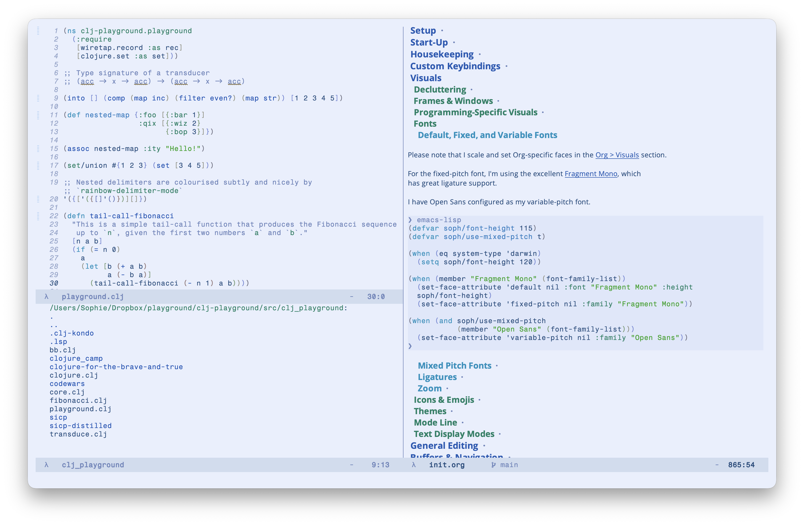
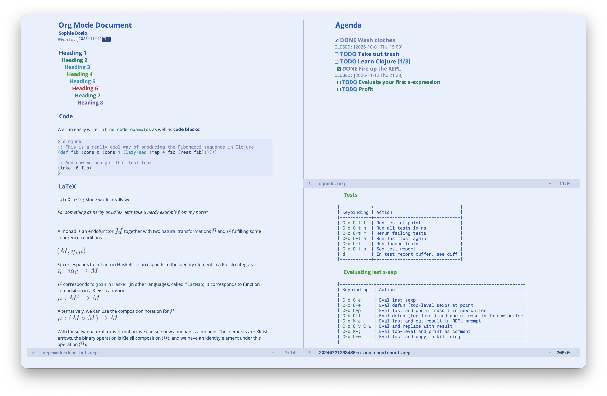
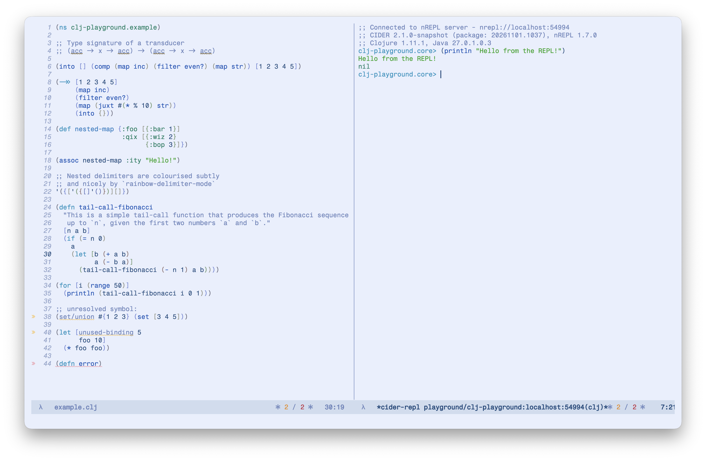

:PROPERTIES:
:ID:       F5B1C52D-C2B2-4D9C-B880-937CBA0E1FC6
:END:
#+title: Sky

A light Emacs theme for blue-light enthusiasts.
Uses mostly blues and greens with soft colours 🦋☁️🩵

I wanted a softer version of my other light theme, [[https://github.com/SophieBosio/south][South]], and I was inspired by Doom Themes' "Nord Light" theme ([[https://github.com/doomemacs/themes/blob/screenshots/doom-nord-light.png][screenshot]]) to make the background a soft light blue and tweak the other colours to go a bit softer.

I've used the very convenient package [[https://github.com/jasonm23/autothemer][autothemer]] to create the theme, which greatly simplified things.
I'd heartily recommend it.

*Note:*
Sky is a work in progress and is subject to constant change, at the whims of the +author+ benevolent dictator.

* Screenshots

*Org Mode*

Big screenshot, small text, showing a regular =org-mode= document with different text styles, an agenda, and some tables.

*Clojure Code*

Some example code, showing Flycheck at work.

* Installation

*Manual Installation*

Clone this repository, usually to some location within your =.emacs.d= directory:

#+begin_src shell
# With SSH:
git@github.com:SophieBosio/sky.git

# With https:
https://github.com/SophieBosio/sky.git
#+end_src

And load the file somewhere in your =init.el=:

#+begin_src emacs-lisp
(load "path/to/sky-theme/sky-theme.el")
#+end_src

*use-package*

With Emacs 30+, you can install packages via version control directly with =use-package=:

#+begin_src emacs-lisp
(use-package sky-theme
  :vc (:url "https://github.com/SophieBosio/sky"
       :rev :newest
       :branch "main"))
#+end_src

#+RESULTS:

* Support

Since I developed Sky for my own personal use, I have only implemented support for the packages I use or have used. Pull requests welcome for additional support.

Otherwise, you can install the theme, use =M-x find-library RET sky-theme RET= to open the source code, edit at will, evaluate the buffer and reload the theme.

Currently, Sky theme defines faces for font lock faces, implicitly supporting most programming languages, and faces for the following packages:
- =ag=
- =cider=
- =company-mode=
- =consult=
- =corfu=
- =diff-hl=
- =flycheck=
- =lsp-mode=
- =magit=
- =orderless=
- =org-mode=
- =vertico=

* Ports

If you decide to fork or port the theme, I'd be super happy to hear about it! Feel free to shoot me an email at sophie.bosio@outlook.com.

Copyright 2024-2025 (c) Sophie Bosio
